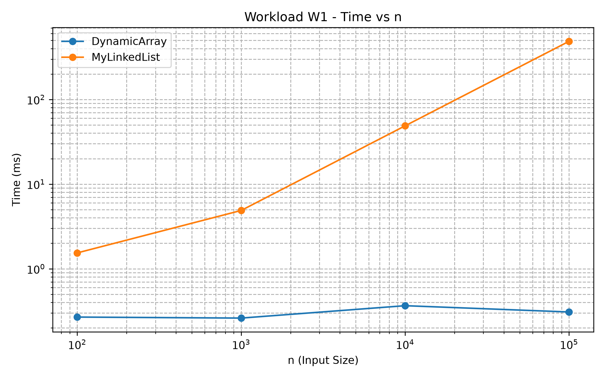
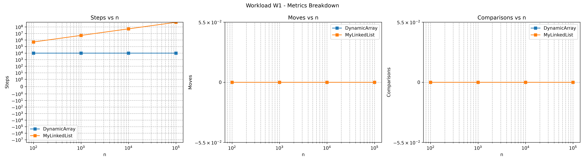
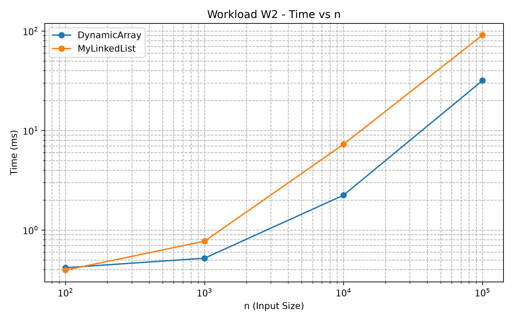
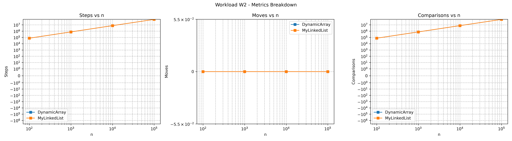
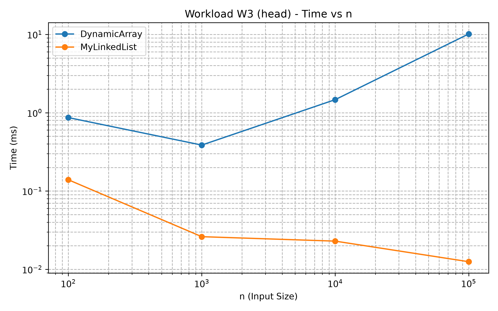
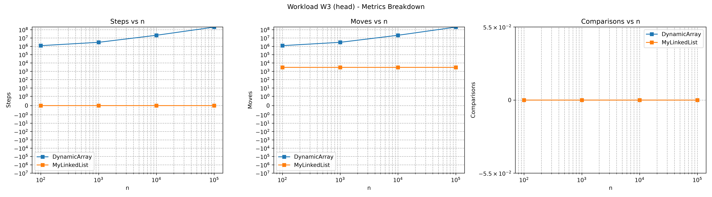
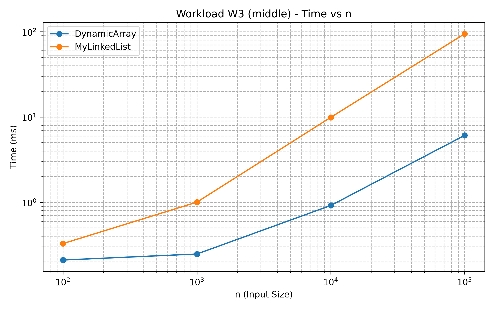
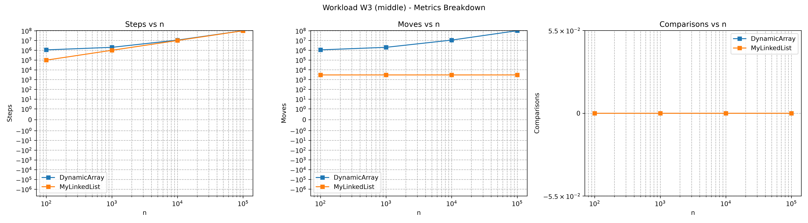
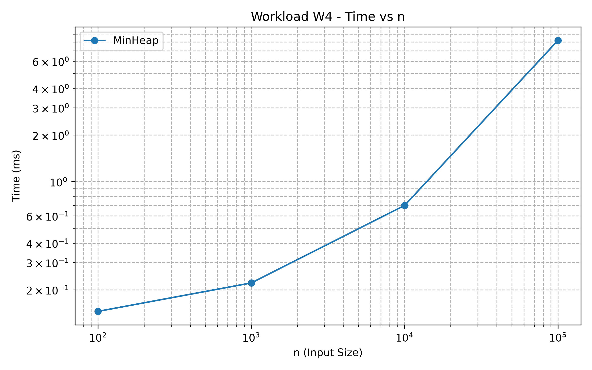
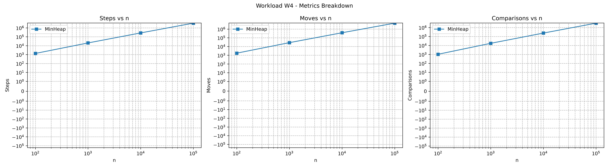

# Assignment 2 — Data Structures: Report

**Course:** Design and Analysis of Algorithms
**Student:** Nurtielu Shugay, group SE-2518
**GitHub:** <вставь ссылку на репозиторий> (branch `main`, tag `v1.0`)

## 1. Complexity Table

n = number of elements. Storage is Θ(n) for all structures; the column "Aux." is the extra memory of one operation.

| Structure | Operation | Best | Average | Worst | Aux. | Justification |
|---|---|---|---|---|---|---|
| DynamicArray | `get(i)` | Θ(1) | Θ(1) | Θ(1) | O(1) | Direct access `data[i]`. |
| DynamicArray | `add(x)` | Θ(1) | Θ(1) amortized | Θ(n) | O(1)* | Resize copies n elements, but doubling makes the average constant. |
| DynamicArray | `add(index, x)` | Θ(1) | Θ(n) | Θ(n) | O(1)* | Shifts `size - index` elements: best at the end, worst at index 0. |
| DynamicArray | `remove(index)` | Θ(1) | Θ(n) | Θ(n) | O(1) | Shifts elements left: best for the last, worst for index 0. |
| DynamicArray | `contains(x)` | Θ(1) | Θ(n) | Θ(n) | O(1) | Linear scan: best if x is first, worst if absent. |
| MyLinkedList | `get(i)` | Θ(1) | Θ(n) | Θ(n) | O(1) | Walks `i` links from `head`. |
| MyLinkedList | `add(x)` | Θ(1) | Θ(1) | Θ(1) | O(1) | `tail` pointer gives the last node directly. |
| MyLinkedList | `add(index, x)` | Θ(1) | Θ(n) | Θ(n) | O(1) | No walk at index 0 or `size`; otherwise walk to the previous node. |
| MyLinkedList | `remove(index)` | Θ(1) | Θ(n) | Θ(n) | O(1) | No walk at index 0; otherwise walk to the previous node (singly linked). |
| MyLinkedList | `contains(x)` | Θ(1) | Θ(n) | Θ(n) | O(1) | Linear scan over nodes. |
| MinHeap | `insert(x)` | Θ(1) | Θ(1) (random data) | Θ(log n) | O(1)* | Bubble-up stops when the parent is not larger; a new minimum climbs the whole height. |
| MinHeap | `peekMin()` | Θ(1) | Θ(1) | Θ(1) | O(1) | Returns `data[0]`. |
| MinHeap | `extractMin()` | Θ(1) | Θ(log n) | Θ(log n) | O(1) | The moved last element usually sinks to the bottom; best case is equal values. |

\* a rare `resize` temporarily allocates a Θ(n) array.

## 2. Loop Invariant Proofs

### 2.1 `DynamicArray.contains(x)`

```java
for (int i = 0; i < size; i++) {
    if (data[i] == x) return true;
}
return false;
```

- **Invariant:** before the iteration with index `i` (0 ≤ i ≤ size), none of `data[0..i-1]` equals `x`.
- **Initialization:** for `i = 0` the range is empty, so it contains no `x`.
- **Maintenance:** if the iteration runs, then `data[i] != x` (otherwise the method returns), so `data[0..i]` has no `x`: the invariant holds for `i + 1`.
- **Termination:** the loop ends either by `return true` (x was found) or with `i == size`, and then the invariant says the whole array has no `x`.
- **Conclusion:** the result is `true` exactly when `x` is in the array, so `contains` is correct.

### 2.2 `DynamicArray.remove(index)` — shifting loop

```java
for (int i = index; i < size - 1; i++) data[i] = data[i + 1];
size--;
```

Let `old` be the array contents before the call.

- **Invariant:** before the iteration `i` (index ≤ i ≤ size-1): (1) `data[0..index-1]` is unchanged; (2) `data[j] == old[j+1]` for all `index ≤ j < i`; (3) `data[i..size-1] == old[i..size-1]`.
- **Initialization:** for `i = index` range (2) is empty and nothing has been modified.
- **Maintenance:** the iteration sets `data[i] = data[i+1] = old[i+1]` (by (3)) and changes nothing else, so (1)–(3) hold for `i + 1`.
- **Termination:** at `i = size - 1` we have `data[j] == old[j+1]` for `index ≤ j < size-1`.
- **Conclusion:** after `size--` the array equals `old` without the element at `index`, in the same order, so `remove` is correct.

## 3. Setup

AMD Ryzen 5, Windows, OpenJDK 25. Data: `new Random(42)`; n = 100, 1 000, 10 000, 100 000. Each case: 1 warm-up run (discarded) + 5 measured runs, the median is saved to `results/results.csv`. Counters are incremented inside the methods: steps = one cell read or move to the next node, moves = one element shift or pointer update (a heap swap = 3 moves), comparisons = one comparison of two elements. Note: `MinHeap.insert` also counts the write to the end as a step and a move, so heap counters are compared only with themselves.

Results for n = 100 000:

| Workload | Structure | time, ms | steps | moves | comparisons |
|---|---|---|---|---|---|
| W1 | DynamicArray | 0.31 | 10 000 | 0 | 0 |
| W1 | MyLinkedList | 487.00 | 504 930 938 | 0 | 0 |
| W2 | DynamicArray | 31.82 | 73 835 543 | 0 | 73 835 543 |
| W2 | MyLinkedList | 91.02 | 73 835 543 | 0 | 73 835 543 |
| W3 head | DynamicArray | 10.14 | 201 099 000 | 201 099 000 | 0 |
| W3 head | MyLinkedList | 0.0125 | 0 | 3 000 | 0 |
| W3 middle | DynamicArray | 6.09 | 101 099 000 | 101 099 000 | 0 |
| W3 middle | MyLinkedList | 94.67 | 99 998 000 | 3 000 | 0 |
| W4 | MinHeap | 8.17 | 3 359 136 | 4 784 540 | 3 059 125 |

## 4. Plots and Observations

**W1 — Random Access.** The array always needs 10 000 steps (O(1) per `get`); the list needs about 10 000 · n/2 steps, so at n = 100 000 it is about 1 580× slower (487 ms vs 0.31 ms).




**W2 — Search.** Steps and comparisons are identical (73 835 543, lines overlap), but the list is about 2.9× slower (91.0 ms vs 31.8 ms). At n = 100 the times are equal (0.418 vs 0.395 ms), which is JIT and timer noise.




**W3 — Insert & Remove.** Head: the array shifts about 2000 · n elements (10.14 ms), the list makes a constant 3 000 pointer updates (0.0125 ms, about 800× faster). Middle: array moves (101 099 000) and list steps (99 998 000) are almost equal, yet the list is about 15.5× slower (94.67 ms vs 6.09 ms).






**W4 — MinHeap.** Time grows from 0.15 ms to 8.17 ms. The ratio comparisons / (n · log₂ n) is 1.56, 1.73, 1.80, 1.84 for the four sizes, almost constant, which matches Θ(n log n). The order check never failed.




## 5. Discussion

In W1 the array needs 10 000 steps and the list about 505 million, so the 1 580× time gap follows from O(1) against O(n) access. An `int[]` is one contiguous block: a 64-byte cache line holds 16 values and the prefetcher loads the next lines in advance, which makes the array fast even for simple iteration. In W2 both structures do the same 73.8 million steps and comparisons, but the list is about 2.9× slower. In W3 middle the array makes about 101 million moves and the list about 100 million steps, but the list is 15.5× slower. A step in the array is a read of a neighbouring cell, while a step in the list is pointer chasing: the next address is known only after the previous node is loaded, so the CPU cannot overlap or prefetch these loads. Each node is also a separate object: with the header, `val` and `next` it typically takes about 24 bytes instead of 4, so a cache line holds only 2–3 nodes. The nodes may be scattered across the heap, and the garbage collector has to manage millions of small objects. Therefore equal Big-O and even equal counters can hide a large constant-factor difference. `MyLinkedList` is better when insertions and removals happen at the head (W3 head: 0.0125 ms vs 10.14 ms), for example in a stack or a queue without index access. `MinHeap` is better for priority scheduling: `peekMin` is O(1) and `insert`/`extractMin` are O(log n), while a sorted array costs O(n) per insertion and an unsorted list needs an O(n) scan for the minimum. Measurements for n = 100 are below 1 ms and noisy, so conclusions rely on the larger sizes.

## 6. Conclusion

The results match the complexity table: array access is constant and list access is linear; shifting hurts the array at the head but beats the list in the middle; the heap grows as n log n. Counters explain the asymptotics, while cache locality, pointer chasing and object overhead explain why equal Big-O can give very different running times.